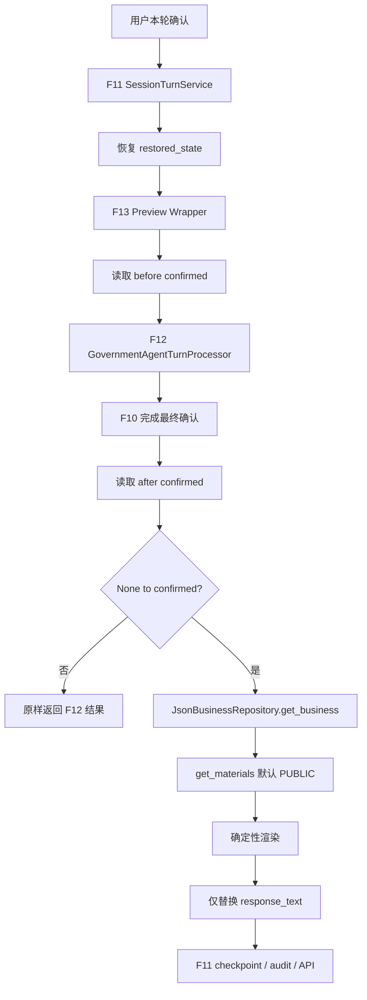

# F13-Preview 已确认事项材料展示：代码阅读指南

Feature：Confirmed Business Materials Demo。

定位：F12 首次确认成功后的确定性材料展示增强。

本文按一次办理怎么走来读代码。文件和函数放在后半部分。

## 1. 这个 Feature 解决什么问题

F12 已经能把事项正式确认下来。确认回答的是“你办的是哪个事项”。用户接下来还需要看到：这个事项当前有哪些可公开办理材料。

F13-Preview 在首次确认之后做四件事：

1. 读取 `confirmed_business_id`。
2. 用这个编号查询受控 Business Data。
3. 取出规范事项名称。
4. 取出当前可公开材料，追加到本轮回复。

这是回复增强，不是新的业务决策节点。F13 不决定办哪个事项，也不改写确认结果。

当前实现叫 Preview，因为它不是完整 F13。它只做：

已确认事项 → 规范名称 → 公开材料。

当前不做：办理地点、办理渠道、办理条件、法律依据、办理时限、完整 Business Knowledge Graph、政务百科、导航、RPA。Business Data 里可以已经存有地点或渠道，Preview 不读取、不展示。

## 2. 先看完整业务链路



读这条链时抓住三件事：F11 拥有会话，F12/F10 拥有确认，F13 只在确认第一次出现时增强回复。

### 2.1 用户发送最终确认

前几轮可能已经产生候选事项。演示数据里，候选可以是 `candidate_business_id = DEMO_SS_001`，同时 `confirmed_business_id` 仍为空。用户本轮说出“确认”，或其它能让 F10 完成确认的内容。

| 项目 | 内容 |
| --- | --- |
| 用户输入 | 本轮自然语言，例如“确认” |
| 接收模块 | F11 先接收整次 turn，再交给 Preview |
| 业务职责 | Preview 不解释这句话是不是确认 |
| 输入 | `session_id`、`request_id`、`input_text`、`restored_state` |
| 输出 | 此时还没有材料展示 |

Preview 把 `input_text` 原样交给 F12。它不做 `input_text == "确认"`。

### 2.2 F11 恢复会话状态

`SessionTurnService` 在调用处理器之前处理会话锁、请求幂等和 checkpoint 恢复。Preview 拿到的是已经恢复好的 `restored_state`。它不直接访问 Redis。

`before_confirmed_id` 的业务含义是：本轮执行之前，这个会话有没有正式事项确认结果。此前没有最终确认时，这个值是 `None`。

### 2.3 Preview 为什么放在 F12 外面

生产链是：

`SessionTurnService` → `ConfirmedBusinessMaterialsPreviewProcessor` → `GovernmentAgentTurnProcessor`。

这是装饰器。F13 没有替换 F12，没有改 F10，也没有改 Decision Graph。它只观察基础处理器执行前后，已确认编号有没有第一次出现。

源码里，外层保存的字段是 `_base_processor` 和 `_business_repository`。阅读时可以说“基础处理器”，落到字段时要写这两个私有名。

### 2.4 处理前状态：before_confirmed_id

`_read_confirmed_id(restored_state)` 从 `read_f10` 读取 `confirmed_business_id`。`state is None`、产物不是映射、或 F10 里没有可用字符串时，返回 `None`。

最终行为：

| 值 | 结果 |
| --- | --- |
| 非字符串 | `None` |
| `""` | `None` |
| 纯空白 | `None` |
| 正常字符串 | 去掉首尾空白后的字符串 |

例如 `"  DEMO_SS_001  "` 变成 `"DEMO_SS_001"`。这是 Review Finding F13P-RV-002 修复后的行为。候选编号不参与这次读取。

### 2.5 F12 仍然负责真正的业务处理

Wrapper 调用 `GovernmentAgentTurnProcessor.process_turn`，原样传入 `session_id`、`request_id`、`input_text`、`restored_state`。一次 turn 只调用一次基础处理器。F13 不第二次执行、不重试 F12、不重放业务流程。

### 2.6 谁真正决定事项已经确认

不是 F13。F10 的终态校验和用户确认仍然负责最终 confirmation。只有 F10 把 `confirmed_business_id` 写入 state 之后，F13 才能观察到。

F10 负责确认事实，F13 只消费确认结果。

### 2.7 处理后状态：after_confirmed_id

处理后再从 `base_result.state` 经 `read_f10` 读取 `confirmed_business_id`，同样走 `_read_confirmed_id`。本 Feature 的典型首次确认是：`before` 为 `None`，`after` 为 `DEMO_SS_001`。

### 2.8 首次确认判断

真实判断是：`before_confirmed_id is None` 并且 `after_confirmed_id is not None`。这叫首次确认。

| before | after | Preview |
| --- | --- | --- |
| None | None | 不展示 |
| None | DEMO_SS_001 | 展示 |
| DEMO_SS_001 | DEMO_SS_001 | 不重复 |
| ID-A | ID-B | 不展示 |

不满足时，直接返回 F12 的 `base_result`，不查仓库。

## 3. candidate_business_id 为什么不能查材料

`candidate_business_id` 是确认完成前的候选。`confirmed_business_id` 是 F10 写入的最终确认。候选即使已经很像正确答案，也还不是确定业务事实。

Preview 不把候选编号当作查询键。示例：`candidate_business_id = DEMO_SS_001`，`confirmed_business_id = None`。结果是不查材料、不展示材料。

### 3.1 为什么下一轮不会重复展示

不是 Preview 自己做了缓存。下一轮恢复出来的状态里，`before_confirmed_id` 已经非空，所以不再满足 `None → confirmed`。这是基于状态的确定性触发。

## 4. 确认之后如何查询办理材料

查询键只有标准化后的 `confirmed_business_id`。

1. `get_business(confirmed_id)` 读取 `canonical_name`。
2. `get_materials(confirmed_id)` 读取默认 PUBLIC 材料。两次调用使用同一个编号。

### 4.1 规范事项名称从哪里来

当前演示数据：`DEMO_SS_001` 的 `canonical_name` 是“灵活就业人员社会保险费申报缴费”。它来自 Business Data，经 `JsonBusinessRepository.get_business` 读出。生产代码里没有把这个名称写成硬编码字符串。名称不来自 LLM、语义检索、用户原话或图节点标题。

### 4.2 材料从哪里来

当前演示材料列表里，公开材料的 `source_text` 是“身份证”。Preview 不自己打开 JSON，不解析 snapshot，不拼装材料事实。它调用仓库，展示字段是 `material.source_text`。不输出 `material_id`、来源文件或核验状态。

### 4.3 谁决定材料是否允许公开

`JsonBusinessRepository.get_materials` 的默认消费模式是 PUBLIC。仓库决定哪些事实可供公开消费。Preview 决定如何把这些公开事实展示给用户。

Preview 不实现第二套 `source_status`、`VerificationStatus`、`TO_CONFIRM`、`VERIFIED` 或 `SOURCE_EXPLICIT` 判断。如果 Preview 再判一次核验状态，仓库规则和展示规则可能分叉。公开规则的单一所有者是仓库。

## 5. 材料如何变成用户看到的文字

渲染函数是 `_render_materials_preview`。它是确定性的，不调用模型，也不做语义重排。有材料时按仓库返回顺序编号：

```text
办理事项：灵活就业人员社会保险费申报缴费
需要准备的材料：
1. 身份证
```

多条材料同样从 1 开始，顺序与入参一致。当前演示材料只有这一条公开材料，不要把它理解成系统还会自动补出第二项。

文案避免“全部材料”“仅需”“只需要”“保证办理成功”。Preview 展示的是当前受控且允许公开的数据，不声明这些数据穷尽了全部现实材料，也不声明办理一定成功。固定用语“需要准备的材料：”是展示标签。

### 5.1 没有公开材料不是系统失败

`get_materials` 返回空列表时，查询成功，只是没有可展示材料。回复仍成功：

```text
办理事项：<canonical_name>
当前暂无可展示的办理材料信息。
```

这和仓库抛异常不同。空列表会进入渲染；异常会进入第 7 节的退让。

规范名称或某条 `source_text` 不是非空字符串时，渲染抛出异常，交给退让，不编造替代文本。

## 6. 为什么只改 response_text

成功增强使用 `dataclasses.replace(base_result, response_text=...)`。只替换 `response_text`。`state`、`requires_user_input`、`public_status` 继续来自 F12 的 `base_result`。

`_append_preview` 的规则：

- 原 `response_text` 非空：原文字符 + `"\n\n"` + 展示段。
- 原 `response_text` 为空：只返回展示段。

原回复不被 `strip`、改写或总结。`strip` 只用于确认编号，以及渲染前检查名称和材料文本是否为空。

### 6.1 Preview 为什么不能写 state

Preview 不修改槽位、图节点、`candidate_business_id`、`confirmed_business_id`、`f09`、`f10` 或 `business_transition`。也不新增 `artifacts["f13_preview"]`。材料展示不是新的权威业务状态。检查点里保存的仍是 F12 产生的 state。

## 7. 两种失败必须区分

### 7.1 F12/base processor 失败

`_base_processor.process_turn` 位于 Preview 的 `try/except` 之外。F12 失败会继续抛出。F13 不能把业务主流程失败伪装成成功，也不会在基础失败之后去查材料。

### 7.2 Preview 自己失败

F12 已经成功确认之后，如果 `get_business`、读取规范名称、`get_materials`、渲染或回复组装失败，Preview 记录 warning，并 `return base_result`。材料增强失败不等于事项确认失败。

确认编号在仓库中找不到时，同样退让：不猜测名称，不把原始编号展示给用户，不制造材料。

### 7.3 Preview failure 日志

事件名是 `materials_preview_failed`。字段只有 `business_id` 和 `error_type`。不记录 `input_text`、完整 state、材料来源、个人信息或接口密钥。

F13P-RV-001 是可观测性一致性问题，严重级别 MINOR。旧事件名是 `f13_preview_failed`，冻结技术设计要求 `materials_preview_failed`。Review Fix 已改名，Re-Review 已关闭。这不是业务错误，也不是状态损坏。

## 8. F11 仍然拥有会话生命周期

F11 负责会话锁、幂等、checkpoint 恢复、成功后的 checkpoint 保存、审计和公开 API 结果。Preview 只是 `AgentTurnProcessor` 包装。它不自己保存检查点，不写 Redis，不写审计。

同一 `session_id` 和 `request_id` 重放时，F11 在调用处理器之前返回已有结果。Preview 因此不会再次执行。F13 不需要自己的缓存、Redis 键或已处理请求集合。

检查点不增加 Preview schema。材料文字是回复增强。若它随公开结果进入 F11 既有幂等缓存，沿用该缓存。

## 9. Production 是怎么接起来的

接线在 `build_session_router`，不在 `main.py`，也不在 `SessionTurnService` 的实现里。`main.py` 和会话服务都没有因本 Feature 修改。

真实变量名是：

```python
base_processor = GovernmentAgentTurnProcessor(
    decision_graph=decision_graph,
    business_repository=business_repository,
    retrieval_service=retrieval_service,
    slot_dependencies=slot_dependencies,
    terminal_dependencies=terminal_dependencies,
)
processor = ConfirmedBusinessMaterialsPreviewProcessor(
    base_processor=base_processor,
    business_repository=business_repository,
)
service = SessionTurnService(
    store=store,
    processor=processor,
    max_input_chars=resolved.session_max_input_chars,
    session_ttl_seconds=resolved.session_ttl_seconds,
)
```

`business_repository` 先构造一次，再交给 F12 构造链和 Preview。两边是同一个 `JsonBusinessRepository` 实例。这样本轮使用同一份已加载快照，避免再构造第二份仓库带来的重复加载和版本不一致。源码没有为此提供事务保证，不要把它理解成数据库事务。

构造 Preview 和组装 composition 时不调用 `get_business` 或 `get_materials`。查询只发生在运行时的首次确认分支。激活测试验证构建阶段这两次调用次数都是 0。

## 10. Review 中发现并关闭的两个问题

两项都是 MINOR，都已在 Re-Review 关闭。它们不是严重缺陷。

F13P-RV-001：可观测性事件名。旧代码写 `f13_preview_failed`，修复为 `materials_preview_failed`。业务分支没有改变。

F13P-RV-002：确认编号标准化。旧代码用 `strip` 判断空白，却返回未去掉空白的原字符串。修复为非空时 `return value.strip()`。无首尾空白的正常 F12 编号，行为不变。带空白的编号在修复后可以按规范编号查询，而不是误走退让。

修复后的运行证据：F13 单元 16 项通过；授权安全回归 77 项通过、0 失败、0 跳过。

## 11. 测试是怎么分层证明这个 Feature 的

测试按“行为、会话、接线”三层证明，而不是按文件名堆清单。

### 11.1 Wrapper 单元测试

`tests/test_f13_preview_materials.py` 用假的基础处理器和可控仓库，验证 Wrapper 自己的语义：首次确认、仅有候选不触发、已经确认不重复、低置信且未确认不触发、解释请求且未确认不触发、空材料成功文案、真实 `JsonBusinessRepository.get_materials` 的默认公开过滤、仓库异常退让、未知业务退让、基础处理器异常原样传播、状态不被改写，以及源码不依赖 LLM 和语义检索。

公开过滤测试在同一快照里放一条能通过仓库规则的材料和一条不能通过的材料，断言隐藏材料不出现在默认 `get_materials` 结果和回复里。规则正文留在仓库。

### 11.2 Session 集成

`tests/test_f13_preview_session_integration.py` 使用真实 `ConfirmedBusinessMaterialsPreviewProcessor`、真实 `SessionTurnService`、假基础处理器和内存存储。它验证材料进入公开回复、检查点保留确认编号且没有 `f13_preview` 产物、同一请求重放时基础处理器只执行一次，以及 Preview 查询失败时会话仍按基础成功结果提交。

### 11.3 Production activation

`tests/test_f13_preview_activation.py` 调用真实 `build_session_router`。它验证外层是 Preview、内层 `_base_processor` 是 `GovernmentAgentTurnProcessor`、两边的 `_business_repository` 是同一对象、构建时材料查询次数为 0，以及健康检查和公开响应字段保持原合同。测试用替身挡住真实 Redis 命令、模型完成和检索调用。

### 11.4 F12 激活测试为什么改了观察方式

`tests/test_f12_app_activation.py` 原来要求 `SessionTurnService` 上的处理器直接是 `GovernmentAgentTurnProcessor`。F13 合法加入外层包装后，这个结构观察过时。测试没有跳过、预期失败或删除。更新后的观察是：

- 外层：`ConfirmedBusinessMaterialsPreviewProcessor`
- 内层：`processor._base_processor` 是 `GovernmentAgentTurnProcessor`
- 仓库：`processor._business_repository is processor._base_processor._business_repository`
- 构建时 `get_business` 与 `get_materials` 调用次数为 0

健康检查和公开字段覆盖仍在。F12 生产代码没有因此修改。改这份测试不等于改 F12 Production。

## 12. 最终运行证据

以下数字来自已批准的授权测试，不是全仓套件。

| 集合 | 结果 |
| --- | --- |
| F13 Unit | 16 passed |
| F13 Session | 3 passed |
| F13 Activation | 2 passed |
| F13 Combined | 21 passed |
| F12 Processor Regression | 18 passed |
| F12 Session Regression | 5 passed |
| F12 Activation Regression | 2 passed |
| Business Repository Regression | 16 passed |
| Business Data Contract Regression | 15 passed |

最终 authorized safe regression：77 passed / 0 failed / 0 skipped。77 是上述 8 个测试文件放在同一次命令里的统一结果，不是把表中各组数字再加一遍得到的新总数。

这次安全回归期间：真实 LLM 调用 0，真实 Redis 命令 0，真实 PostgreSQL 连接 0，Embedding 加载 0，外网调用 0。这是测试执行证据。生产 composition 在真实运行时仍会按既有配置连接 Redis，并保留 F12 原有的模型和检索依赖。F13 Preview 自己不调用这些资源。

`FULL_SUITE_EXECUTED = NO`。Owner 授权的是明确安全的相关测试集。不能写成“全仓测试通过”。

## 13. 用一条完整示例串起来

初始状态：`candidate_business_id = DEMO_SS_001`，`confirmed_business_id = None`。用户说“确认”。

1. F11 恢复旧 state。
2. Preview 读到 `before = None`。
3. F12/F10 完成确认，`base_result.state` 中 `confirmed_business_id = DEMO_SS_001`。
4. Preview 读到 `after = DEMO_SS_001`，满足 `None → confirmed`。
5. 仓库返回规范名称“灵活就业人员社会保险费申报缴费”，公开材料“身份证”。
6. 回复保留 F12 原文，空一行后追加展示段。
7. `state` 仍是 F12 返回的 state。F11 继续保存检查点、审计和 API 结果。

### 13.1 只有候选时

`candidate_business_id = DEMO_SS_001`，处理前后 `confirmed_business_id` 都是 `None`。Preview 不查询仓库，不生成材料段，直接返回 F12 结果。

### 13.2 已经确认后的下一轮

`before = DEMO_SS_001`，`after = DEMO_SS_001`。用户可以继续提问。Preview 不重复展示材料。

### 13.3 材料查询失败

F12 确认成功，`after = DEMO_SS_001`，但 `get_materials` 或 `get_business` 抛出异常。Preview 记录 `materials_preview_failed`，返回原来的 `base_result`。确认状态仍保留，本轮只是没有材料展示。

## 14. 每个模块到底负责什么

| 模块 | 负责 | 不负责 |
| --- | --- | --- |
| F11 `SessionTurnService` | 会话锁、幂等、checkpoint、审计、公开结果 | 判断办哪个事项，生成材料文案 |
| F12 `GovernmentAgentTurnProcessor` | Agent 主流程 | Preview 材料展示 |
| F10 | 最终事项确认，写入 `confirmed_business_id` | 材料事实和公开过滤 |
| F13 Preview | 首次确认检测、回复增强 | 流程决策、写 state |
| `JsonBusinessRepository` | 事实查询、PUBLIC 过滤 | 用户会话 |
| Business Data | 受控事实，含规范名称和材料 `source_text` | 会话状态 |
| `_render_materials_preview` | 确定性展示文本 | 判断事实是否公开 |

## 15. 最后再回到代码文件

### 15.1 `materials_preview.py`

`ConfirmedBusinessMaterialsPreviewProcessor` 是 Preview 包装。

`process_turn` 的业务角色是一次 turn 的观察与可选增强。输入是 `session_id`、`request_id`、`input_text`、`restored_state`。处理顺序是读 before、调用 `_base_processor.process_turn` 一次、读 after、按首次确认决定是否增强。输出是 `AgentTurnResult`。基础异常继续抛出；Preview 自有异常返回原 `base_result`。

`_read_confirmed_id` 的业务角色是把 F10 里的确认编号收成 `None` 或去空白后的字符串。输入是 `AgentState | None`。它只读 `read_f10` 的 `confirmed_business_id`。

`_is_first_confirmation` 只判断 `before is None and after is not None`。

`_build_preview_section` 用同一个确认编号调用 `get_business` 和默认 `get_materials`，再交给渲染。

`_render_materials_preview` 生成展示段。空材料走固定空态文案。名称或 `source_text` 空白时抛出 `ValueError`。

`_append_preview` 把展示段接到原回复后面，或在原回复为空时只返回展示段。

### 15.2 `composition.py`

`build_session_router` 负责生产接线：构造 `base_processor`，用同一个 `business_repository` 包成 `processor`，再交给 `SessionTurnService`。`main.py` 只是继续使用这条会话路由，本 Feature 没有改它。

### 15.3 测试文件

| 文件 | 对应证明 |
| --- | --- |
| `tests/test_f13_preview_materials.py` | Wrapper 语义 |
| `tests/test_f13_preview_session_integration.py` | F11 集成与幂等 |
| `tests/test_f13_preview_activation.py` | 生产接线 |
| `tests/test_f12_app_activation.py` | 外层包装加入后的 F12 处理器链兼容回归 |

## 16. 推荐源码阅读顺序

1. 先看 `tests/test_f13_preview_materials.py`，理解 Feature 行为。
2. 再看 `materials_preview.py`，理解实现。
3. 再看 `terminal.py` 里的 `read_f10`，理解 `confirmed_business_id` 从哪里读出。确认如何写入仍属于 F10。
4. 再看 `composition.py`，理解接线。
5. 再看 `session/service.py`，理解 F11 在处理器之前做幂等、在处理器之后做提交。
6. 最后看两份激活测试，理解生产链和健康检查、公开字段没有被 Preview 改掉。

## 17. 容易读错的几个点

1. `candidate_business_id` 不等于 `confirmed_business_id`。
2. F13 不决定事项。确认事实属于 F10。
3. F13 不自己判断材料是否公开。公开规则属于 `JsonBusinessRepository`。
4. F13 不写 state，也不新增 `artifacts["f13_preview"]`。
5. fail-soft 不包括基础处理器。F12 异常继续抛出。
6. 幂等属于 F11，发生在处理器调用之前。
7. F13-Preview 不是完整 F13，也不是 Business Knowledge Graph。
8. 更新 `tests/test_f12_app_activation.py` 的结构观察，不等于修改 F12 Production。

## 18. 以后完整 F13 可以怎么扩

以后可以继续用同一个 `confirmed_business_id` 做确定性查询，扩展地点、渠道、条件、法律依据等办理信息。这些目前未实现。本文不定义未来类名、接口或响应字段。
