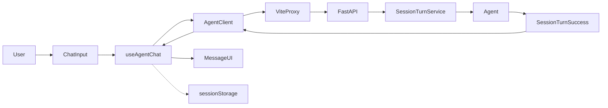

# F14 — 政务 Agent Web 汇报与交互前端 Technical Design

Technical Design Status：DRAFT / READY FOR OWNER REVIEW。

## 1. Technical Design Overview

本设计说明如何在不修改现有 Agent 业务语义的前提下，于同一仓库新增独立前端根目录 `frontend/`，实现阶段成果汇报与真实 Agent 多轮交互。

核心链路：

```text
Browser
→ Vite Dev Server
→ Vite Proxy
→ FastAPI
→ F11 SessionTurnService
→ F12 / F10 / F13-Preview
→ Public Session Response
→ Browser UI
```

前端只负责界面与传输生命周期。后端继续拥有全部业务事实与业务决策。

## 2. Frozen Requirement Reference

| 项 | 值 |
| --- | --- |
| Requirement | `docs/features/F14-web-demo-frontend.md` |
| Freeze Commit | `a343bdb4fbb91665cae7dd7f00b24d1fd2d2a08f` |
| Blob Hash | `e239ed47cb3f3f84bdc1f99fa25c0debf9fb2085` |
| Resource Gate | PASS_WITH_INTEGRATION_GAPS / OWNER REVIEW APPROVED |
| F12 | CLOSED |
| F13-Preview | FINAL CLOSED / REMOTE-FROZEN |

本 TD 不重新定义业务需求。若实现前发现 Frozen Requirement 与代码无法兼容，停止并请求 Owner 决策，不修改 Requirement。

## 3. Architecture Goals

1. 浏览器用户输入必须调用现有 `POST /api/v1/session/turn`。
2. Agent 回复必须来自真实公开响应中的 `response_text`。
3. 开发环境通过 Vite proxy 同源访问后端，不修改 Backend CORS。
4. 前端不实现候选判断、确认判断、材料公开资格或其它业务决策。
5. 静态汇报与实时 Demo 视觉与数据来源分离。
6. Backend Production Path Count = 0。

## 4. System Topology

第一版开发拓扑：

```text
Browser  http://localhost:5173
   │
   ├── GET /health
   └── POST /api/v1/session/turn
   ▼
Vite Development Server  localhost:5173
   │  proxy
   ▼
FastAPI  http://127.0.0.1:8000
   ▼
Existing Agent Backend
```

禁止浏览器跨域直连后端。禁止浏览器直连 LLM。生产托管拓扑不在本 Feature 第一版实现范围内。

## 5. Frontend Technology Stack

| 决策 | 值 |
| --- | --- |
| Frontend Root | `frontend/` |
| UI | React |
| Language | TypeScript |
| Bundler / Dev Server | Vite |
| Styling | Tailwind CSS |
| Icons | Lucide React |
| Motion | Framer Motion |
| Package Manager | npm |

不引入：Next.js、Vue、Angular、Redux、MobX、Zustand、ECharts、Material UI、Ant Design、后端模板渲染。

DEPENDENCY_VERSION_POLICY = LOCKFILE_PINNED_AT_IMPLEMENTATION。

Implementation Stage 初始化时使用兼容的稳定发行版本。`package.json` 不得使用 `"*"`。最终实际版本以 Implementation 生成并 Review 的 `package.json` 与 `package-lock.json` 为准。`package-lock.json` 必须进入版本控制。安装完成后，后续测试与 Review 不得无故升级依赖。

## 6. Frontend Directory / Module Architecture

推荐结构：

```text
frontend/
├─ index.html
├─ package.json
├─ package-lock.json
├─ vite.config.ts
├─ tsconfig*.json
├─ README.md
└─ src/
   ├─ main.tsx
   ├─ App.tsx
   ├─ styles/
   ├─ api/
   │  ├─ agentClient.ts
   │  └─ contracts.ts
   ├─ hooks/
   │  ├─ useAgentChat.ts
   │  └─ useAgentHealth.ts
   ├─ storage/
   │  └─ sessionStorage.ts
   ├─ content/
   │  └─ presentation.ts
   └─ components/
      ├─ navigation/
      ├─ sections/
      └─ chat/
```

本 TD Stage 不创建上述文件。Implementation 允许合并小组件，避免过度拆分。

## 7. Component Architecture

按页面业务区域拆分，不以每个视觉元素为单位碎片化。

预期核心组件：

- `App`
- Header / Navigation
- `HeroSection`
- Current Achievements
- `ArchitectureSection`
- `AgentDemoSection`
- `RoadmapSection`
- `ReliabilitySection`
- `ValidationSection`
- `NextStepsSection`
- `ChatPanel`
- `ChatInput`
- `MessageBubble`
- `ServiceStatus`
- App-level `ErrorBoundary`

Implementation 可按合理性合并。第一版无 Router。`App` 直接组织单页 sections，导航使用 section id + smooth scroll。

页面顺序：Hero → Current Achievements → Architecture → Real Agent Demo → Roadmap → Reliability → Validation Evidence → Next Steps。

## 8. Static Presentation Data

静态汇报内容集中在 `frontend/src/content/presentation.ts`，不得散落在大量组件中。

内容包括：项目标题、说明、KPI cards、Architecture steps、Roadmap、Reliability cards、Validation evidence、Next-stage planning。

这是 Presentation Configuration，不是 Backend Business Data。不得把真实 Agent 回复放入该文件。静态证据为 curated content，不动态读取 Git history。

第一版静态证据至少包括：

- F13-Preview：FINAL CLOSED / REMOTE-FROZEN
- Final Authorized Safe Regression：77 passed / 0 failed / 0 skipped
- Review：PASS / CLOSED

并注明：77 passed 不代表全仓测试总量。不得写“F14 已完成”。

## 9. Public API Contracts

`contracts.ts` 只定义现有公开接口。

```ts
type SessionTurnRequest = {
  request_id: string
  session_id?: string
  input_text: string
}

type SessionTurnSuccess = {
  session_id: string
  request_id: string
  status: "COMPLETED" | "AWAITING_USER_INPUT"
  response_text: string
  requires_user_input: boolean
}

type SessionTurnError = {
  request_id: string | null
  session_id: string | null
  status: "FAILED"
  error: { code: string; message: string }
}

type HealthResponse = {
  status: "ok"
}
```

不得定义：`candidate_business_id`、`confirmed_business_id`、`AgentState`、F09/F10 artifact、Checkpoint。

TypeScript interface 不能代替 runtime validation。第一版不引入 Zod 或 Yup。使用小型显式 type guard / response parser 校验关键公开字段。不符合公开合同的响应转换为 Frontend `INVALID_RESPONSE`，不得按成功消息展示。

## 10. API Client

统一客户端 `agentClient.ts` 提供：

- `checkHealth()`
- `sendTurn(...)`

组件不得直接散落 `fetch`。API Client 负责 JSON 序列化、HTTP 状态处理、公开响应解析、超时与 `AbortController`、前端传输错误归一化。

业务代码只使用同源路径：

- `GET /health`
- `POST /api/v1/session/turn`

`Content-Type: application/json`。payload 只发送 `request_id`、`input_text`，以及可选的 `session_id`。不得发送 extra fields。

请求构造：

```text
payload = { request_id, input_text }
if sessionId != null:
  payload.session_id = sessionId
```

不得把 `session_id: null` 作为标准 payload。首次请求字段缺失。

INPUT_NORMALIZATION = TRIM_BOUNDARIES。发送前用 `input.trim().length > 0` 判断非空，真正发送 trim 后文本。不得改写、总结或纠错。textarea `maxLength = 4000`，并展示字符计数。Backend 仍是最终 Validator。

## 11. Vite Proxy

| 项 | 值 |
| --- | --- |
| Frontend port | `5173` |
| Proxy target | `http://127.0.0.1:8000` |
| Proxied paths | `/api`、`/health` |
| Path rewrite | 无 |

浏览器仍请求 `POST /api/v1/session/turn`。Backend absolute URL 只出现在 Vite development config，不得出现在 React 组件、Chat state 或 presentation data。

若 5173 被占用，不得静默换端口后让汇报人员不知道。启动命令必须明确报告实际地址。Requirement 仍以 5173 为标准 Demo port。

Vite Proxy 只属于开发联调机制。生产反向代理与静态托管 OUT OF CURRENT SCOPE。

## 12. Health Lifecycle

Health State：`UNKNOWN` | `CHECKING` | `AVAILABLE` | `UNAVAILABLE`。

| 参数 | 值 |
| --- | --- |
| HEALTH_POLL_INTERVAL | 30 seconds |
| HEALTH_TIMEOUT | 3000ms |

页面初次加载异步发起 health check。页面本体不等待 health 即可 render。页面卸载时取消 timer 与 in-flight request。

AVAILABLE 只表示 `GET /health` 按公开合同成功返回。UI 文案为“Agent 服务正常”或“Agent 服务当前不可用”。不得写数据库、Redis、LLM 或全部依赖健康。

Health 是 advisory。`UNKNOWN` 不得永久阻止发送。`UNAVAILABLE` 可显示警告，但第一版不把 health 作为发送的唯一 gate；真实 `sendTurn` 仍可尝试，以 Session API 实际结果为准。

## 13. Session Lifecycle

Chat Session State 至少包括：

- `serverSessionId: string | null`
- `messages: ChatMessage[]`
- `pendingRequest: PendingRequest | null`
- `transportError: FrontendError | null`

`serverSessionId` 只能来自 `SessionTurnSuccess.session_id`。禁止前端自己生成。

### 13.1 New Turn

1. trim input
2. 检查非空
3. 生成新 UUID4 `request_id`
4. 读取当前 `serverSessionId`
5. 若为 `null`，请求中完全省略 `session_id`
6. 若非 `null`，发送该 `session_id`
7. 立即把用户消息加入 UI
8. 建立 `pendingRequest`
9. disable send
10. 发送 API

### 13.2 First Turn Success

Frontend 无 `session_id`。Backend 返回 `session_id = S1`。Frontend 先保存 `S1`，再展示 `response_text`，并同步 `sessionStorage`。之后所有新 Turn 使用 `S1`。

### 13.3 Existing Session Success

后续成功响应中的 `session_id` 原则上等于当前 Session。若不一致，视为 `INVALID_RESPONSE` / `SESSION_ID_MISMATCH`，不得静默切换 Session。

### 13.4 New Session

点击新建会话：清除 `S1`、messages、retry context。不调用 Backend。若当前已有消息，显示轻量确认：“开始新会话将清空当前页面中的对话展示，是否继续？”无消息时直接执行。这只影响 Frontend UI，不删除 Backend state。

下一次 Turn：`Rnew`、无 `session_id`。Backend lazy-create `S2`。

## 14. Request Lifecycle

每个新用户业务 Turn 生成新的 UUID4 `request_id`，推荐 `crypto.randomUUID()`。不得使用时间戳、递增整数或随机短字符串。

`pendingRequest != null` 且请求仍在进行时：发送按钮 disabled，Enter 不得再次提交，新建会话按钮也 disabled。避免同 Session 并发 Turn 与异步 Session race。

TURN_REQUEST_TIMEOUT = 90000ms。Timeout 进入可重试 Transport Error，不得生成假 Agent 回复。

Latency 使用 `performance.now()`，从 fetch dispatch 到完整 Public Response 成功解析。显示为“本次请求耗时”，不得标“LLM latency”。

发送消息后聊天区域滚到底部；收到回复后滚到最新消息。不得让整个汇报页面突然跳到顶部。

## 15. Idempotency / Retry

PendingRequest 至少保存：`requestId`、`inputText`、`sessionIdAtDispatch: string | null`、`startedAt`。

可重试失败点击 Retry：直接复用上述三者。不得重新生成 `request_id`。若 `sessionIdAtDispatch == null`，Retry 继续省略 `session_id`。

失败后用户修改输入并重新发送：清除旧 retry context，创建新 `request_id`，视为 NEW TURN。不得出现旧 `request_id` + 新 `input_text`。

Backend 返回的 `request_id` 必须等于 `pendingRequest.requestId`。不一致则为 `INVALID_RESPONSE`。

## 16. Storage / Refresh

统一前缀：`gov-agent-demo:v1:`。

| Key | 用途 |
| --- | --- |
| `gov-agent-demo:v1:session-id` | 服务端签发的 session_id |
| `gov-agent-demo:v1:messages` | 聊天 UI history |
| `gov-agent-demo:v1:pending-request` | pending retry 最小事实 |

集中在 `storage/sessionStorage.ts`。第一版只使用 `sessionStorage`，不使用 `localStorage` 或 IndexedDB。

App 初始化：立即 React render → restore sessionStorage → start health check。不得 await health 之后才 render。

JSON 损坏：fail-safe 清理该 key，页面继续启动，不得白屏。

若刷新前存在 pending request：刷新后不得自动重新发送。UI 显示“上次请求未确认完成”，允许用户手动 Retry。

第一版仅保存当前标签页当前 Demo session 的 UI messages。不提供历史会话列表、会话切换器、搜索或后台记录浏览。

## 17. Error Model

Frontend Error Category：

`NETWORK_ERROR`、`TIMEOUT`、`INVALID_REQUEST`、`SESSION_NOT_FOUND`、`SESSION_EXPIRED`、`REQUEST_ID_REUSE_CONFLICT`、`REQUEST_IN_PROGRESS`、`AGENT_FAILURE`、`PERSISTENCE_UNAVAILABLE`、`INVALID_RESPONSE`、`UNKNOWN_ERROR`。

映射：

| 来源 | Category |
| --- | --- |
| 422 `INVALID_REQUEST` | `INVALID_REQUEST` |
| 404 `SESSION_NOT_FOUND` | `SESSION_NOT_FOUND` |
| 410 | `SESSION_EXPIRED` |
| 409 `REQUEST_ID_REUSE_CONFLICT` | `REQUEST_ID_REUSE_CONFLICT` |
| 409 `REQUEST_IN_PROGRESS` | `REQUEST_IN_PROGRESS` |
| 500 | `AGENT_FAILURE` |
| 503 | `PERSISTENCE_UNAVAILABLE` |
| Abort timeout | `TIMEOUT` |
| Fetch/network failure | `NETWORK_ERROR` |
| 未知 | `UNKNOWN_ERROR` |

允许显示 Retry：`NETWORK_ERROR`、`TIMEOUT`、`AGENT_FAILURE`、`PERSISTENCE_UNAVAILABLE`。

默认不 Retry：`INVALID_REQUEST`、`SESSION_NOT_FOUND`、`SESSION_EXPIRED`、`REQUEST_ID_REUSE_CONFLICT`。

`REQUEST_IN_PROGRESS`：第一版不自动 polling；显示“当前请求仍在处理中”；允许稍后对同一 Pending Request 手动 Retry，不得生成新 `request_id`。

`SESSION_NOT_FOUND` / `SESSION_EXPIRED`：保留历史消息，当前 Session 标记 INVALID，主要 CTA 为新建会话。不得 silently reset。

Error 不得变成假 assistant reply。

## 18. Response Validation

成功响应至少校验：

- `session_id`、`request_id`、`status`、`response_text`、`requires_user_input` 类型正确
- `status` 为 `COMPLETED` 或 `AWAITING_USER_INPUT`
- `COMPLETED → requires_user_input === false`
- `AWAITING_USER_INPUT → requires_user_input === true`
- `request_id` 等于 pending
- 非首次时 `session_id` 等于当前 `serverSessionId`

`status` 可显示小型状态标签。“等待您补充信息”或“本轮处理完成”仅作公开 UI hint，不得据此猜测 F09/F10 内部阶段。下一问内容仍只使用 `response_text`。

## 19. Chat Rendering

第一版不引入 Markdown renderer。`response_text` 使用 plain text + CSS `white-space: pre-wrap`。不使用 `dangerouslySetInnerHTML`。

ChatMessage 仅用于 UI，推荐字段：`local_id`、`role: "user" | "assistant" | "error"`、`text`、`request_id`、`created_at`、`latency_ms?`、`status?`、`requires_user_input?`。若保存 API status，字段名必须是 `status`，不得使用未出现在成功响应中的旧状态字段名。

`local_id` 只用于 React key / UI identity，可用 `crypto.randomUUID()`。它不是 `request_id`、`session_id` 或 `business_id`。

示例问题按钮只填入：“我辞职了，现在没单位，想自己交社保”。不得自动发送，不得加载预置 response。不得把“灵活就业人员社会保险费申报缴费”或“身份证”写成 ChatPanel fallback。

## 20. Visual System

Light Theme。主背景白色 / 浅灰。主色政务蓝。Success 绿、Warning 橙、Error 红、Future 灰。不要高饱和霓虹风。

静态成果区使用普通展示 Card。实时 Demo 区明显标识“实时 Agent Demo”。Service Status 来自 Health。Agent messages 来自 Session API。Roadmap / 77 passed 不得设计成实时监控数字。

Tailwind 负责 layout、spacing、typography、responsive、cards、states。少量全局 CSS 负责 scroll behavior、pre-wrap、特殊 flow connector、必要动画 fallback。不得建立庞大自定义 CSS 系统。

Framer Motion 仅用于 section reveal、轻量 card entry、状态切换、必要 typing presentation。禁止持续复杂 motion loop、3D、粒子背景。`prefers-reduced-motion` 时降级。

Lucide React 为统一图标来源，不得混用多个 icon library。

## 21. Responsive / Accessibility

Desktop First。重点分辨率：1920×1080、1440×900、1366×768。Agent Demo 宽屏双栏；空间不足时上下堆叠。不得出现核心按钮不可点击、文本溢出、聊天区水平滚动。

可访问性：semantic HTML、明确 button type、textarea label、必要 aria-label、适度 aria-live、keyboard submit、visible focus、非纯颜色状态表达、`prefers-reduced-motion`。

Sticky Header。Section ids：`overview`、`architecture`、`demo`、`roadmap`、`validation`、`next`。点击使用 `scrollIntoView` / anchor smooth scroll。

Architecture 可视化不用图表库，使用 React layout、cards、CSS connector、Lucide icons。流程：用户自然语言 → 语义理解 → Semantic RAG → Business Decision Graph → F09 → F10 → Business Repository → F13-Preview → 用户回复。明确标注“架构说明，不是实时 Trace”。

Roadmap 使用 Timeline / Stepper，状态为 Completed / Future。不要把 commit hash 作为领导主视图。

## 22. Security Boundary

Frontend bundle 不得包含 LLM API key、DB credential、Redis credential、Backend secret。第一版不新增 `.env` 中的敏感配置，不得存在 `VITE_LLM_API_KEY` 等项。

Frontend 不得访问 Redis、PostgreSQL、Business Data JSON、Decision Graph JSON、audit storage、checkpoint storage。所有实时业务信息只能通过 Public FastAPI contract。

Production 默认不输出完整 API response、user conversation、credentials、internal exception payload。不新增 logging library。

浏览器基线：`crypto.randomUUID()`、`fetch`、`AbortController`、`sessionStorage`、`performance.now()`。不为 IE 或旧版浏览器提供兼容层。

## 23. Failure Isolation

Health failure 只影响 Service Status / Demo。Session API failure 只影响当前 Chat request。上述失败不得导致 App crash、静态 sections 消失或白屏。

App-level ErrorBoundary 捕获 React render error。Fallback：“页面组件加载异常，请刷新页面。”不得把 API errors 交给 ErrorBoundary；API errors 由 Chat / Health state 处理。

## 24. Testing Strategy

三层：

| Layer | 内容 | Backend |
| --- | --- | --- |
| A | Pure / API Contract Tests | mocked fetch |
| B | React Component / Hook Tests | mocked |
| C | Real Backend Integration Smoke | real，需 Owner 授权 |

工具：Vitest、React Testing Library、`@testing-library/user-event`、jsdom。第一版不引入 Jest、Cypress、Playwright。

Mock 只存在 Test Code，不得进入 Production UI。不得把 mocked frontend tests 表述成真实 Agent 已联调成功。

## 25. Real Agent Integration Smoke

Code Stage 可完成前端实现与 mocked 测试。Feature 最终 Test PASS 前，必须至少尝试真实 Backend integration smoke，并明确记录资源状态。若 Owner 未授权真实 Runtime Resources，不得伪造 REAL INTEGRATION PASS。

Smoke 流程：

1. 启动现有 Backend 所需资源
2. 启动 Backend
3. 启动 Vite Frontend
4. 打开真实页面
5. 检查 `GET /health`
6. 从 UI 发真实首 Turn
7. 确认 Request 没有 `session_id`
8. Backend 返回 server-issued `session_id`
9. 继续多轮输入
10. 确认前端复用 `session_id`
11. 若当前业务数据与模型结果允许，走到真实 F13-Preview 响应
12. 确认页面展示真实 `response_text`

不得使用固定 Mock response。失败时区分 Frontend Defect、Backend Runtime Resource Failure、Existing Agent Failure。不得为了变绿修改 F12/F13 业务逻辑。

## 26. Build / Package Strategy

`package.json` 至少提供：`dev`、`build`、`test`。推荐 `test:run` 用于非 watch。是否增加 lint 由 Implementation 根据实际 scaffold 决定。TD 不强制额外 lint framework。

Test Stage 必须包括 `npm run build`：TypeScript compile success 与 Vite production build success。不得把 “dev server 可启动” 作为唯一前端验收。

后续优先 `npm ci`。首次初始化允许 `npm install` / scaffold 生成 lockfile。

Implementation 在 `frontend/` 初始化 React + TypeScript + Vite，再加入 Tailwind、Lucide、Framer Motion、Vitest、RTL、user-event、jsdom。删除无关 scaffold，不得保留假 Agent messages、mock business cards 或 sample counter。

## 27. Implementation Scope Forecast

### Expected New Paths

主要位于 `frontend/**`，包括 scaffold、Production Code、Tests、`frontend/README.md`、必要 config。

### Potential Existing Paths

| Path | 条件 |
| --- | --- |
| `.gitignore` | 当前已有 `dist/`，缺少 `node_modules/`。若 Code Stage 初始化前端，Confirm 可将其列为唯一根目录配置修改 |
| 根 `README.md` | 不修改。前端启动说明放 `frontend/README.md` |

### Explicitly Zero

| 类别 | Count |
| --- | --- |
| Backend Production Changes | 0 |
| Existing Python Test Changes | 0 |
| Requirement / TD docs in Code Stage | 0 |

若 Code Stage 需要修改 Backend：STOP，请求 Owner scope amendment。不得顺手加 CORS。

除必要 ignore/config 外，第一版所有 Frontend 文件优先位于 `frontend/`。

## 28. Responsibility Table

| 模块 | 负责 | 不负责 |
| --- | --- | --- |
| Browser UI | 输入与展示 | 业务决策 |
| API Client | transport、validation、error normalization | 会话业务语义 |
| Chat Hook | session/request lifecycle | F09/F10 状态机 |
| Storage | sessionStorage UI persistence | Agent State SoT |
| Presentation Content | 静态汇报配置 | 真实 Agent 回复 |
| Vite Proxy | development same-origin transport | 生产托管 |
| FastAPI Backend | 真实 Agent public contract | 浏览器 UI |
| SessionTurnService | idempotency / session / checkpoint | 材料事实判断 |
| Agent / F12 / F13 | 业务处理 | 前端布局 |

## 29. Flow / Sequence Diagrams

### 29.1 Overall Data Flow



`sessionStorage` 旁路保存：server-issued session id、UI history、pending retry context。

### 29.2 First Turn

```text
User → Frontend: input
Frontend: request_id = R1
Frontend → Backend: request_id R1, input_text, NO session_id
Backend: lazy create S1
Backend → Frontend: session_id S1, response_text
Frontend: persist S1
```

### 29.3 Subsequent Turn

```text
Frontend → Backend: request_id R2, session_id S1, input_text
Backend → Frontend: session_id S1
```

不得静默变成 `S2`。

### 29.4 Retry

```text
失败: R2 / S1 / X → timeout
Retry: R2 / S1 / X

首 Turn 失败: R1 / no session / X
Retry: R1 / no session / X
```

### 29.5 New Session

```text
New Session click
Frontend: clear S1, messages, retry
No Backend call
Next Turn: Rnew, no session_id
Backend: lazy create S2
```

### 29.6 Error Flow

```text
HTTP / network error
→ AgentClient normalization
→ Chat Hook state
→ Error UI
→ Retry or New Session
```

不得：Error → fake assistant reply。

## 30. Requirement Traceability

| Requirement | Design |
| --- | --- |
| FR-003 Health | Health lifecycle + `checkHealth` |
| FR-004/005 Real Agent API | AgentClient + `/api/v1/session/turn` |
| FR-006~009 Session lifecycle | Chat hook + server-issued session_id |
| FR-010~013 Request/retry | UUID4 new turn + pending reuse |
| FR-014 Response | `response_text` only from API |
| FR-019 Duplicate guard | pending disables send |
| FR-020~023 Loading/error | pending state + error categories |
| FR-025/026 Refresh/storage | sessionStorage restore, fail-safe |
| FR-027 Backend unavailable | static sections always render |
| FR-033 Example input | fill-only button |
| FR-035 Latency | `performance.now()` |
| FR-036 Safe rendering | pre-wrap, no raw HTML |
| FR-041/042 Proxy/CORS | Vite proxy, no Backend CORS |
| FR-043 Static/live boundary | presentation.ts vs live API |
| FR-044/045 Public status UI | status/requires_user_input hints only |
| FR-046 Backend semantic preservation | Backend changes = 0 |
| NFR-003 No white screen | ErrorBoundary + independent sections |
| NFR-007 No credentials | security boundary |
| AC first-turn no session_id | API + hook tests |
| AC real multi-turn | real integration smoke |
| AC retry request_id reuse | hook tests |
| AC backend unavailable page works | component tests |
| AC F13 real response | real Agent smoke |

## 31. Test Traceability

| Acceptance Focus | Layer |
| --- | --- |
| Health success/failure | A + B |
| First turn omits session_id | A + B |
| Existing session includes session_id | A + B |
| UUID request_id / mismatch defense | A + B |
| Session mismatch defense | A + B |
| Invalid response rejected | A |
| HTTP error mappings | A |
| Network / timeout | A |
| New turn / retry / first-turn retry | B |
| New session clear | B |
| No concurrent submit | B |
| Refresh restore / corrupt storage | B |
| Pending restore no auto-send | B |
| 404/410 no silent create | B |
| Static page without Backend | B |
| Chat send / loading / response | B |
| Example fill only / no mock output | B |
| Keyboard send / Shift+Enter / 4000 | B |
| Validation evidence wording | B |
| `npm run build` | Build validation |
| Real multi-turn + F13 response when eligible | C smoke |
| Manual desktop sizes | Manual evidence |

API tests至少覆盖：health success/failure；first turn omits session_id；existing session includes session_id；request UUID；success validation；request_id mismatch；session_id mismatch；invalid response；422/404/410/409 reuse/409 in-progress/500/503；network；timeout。

Hook tests至少覆盖：first turn gets backend session_id；second turn reuses it；new turn gets new request_id；retry reuses request_id and input；first-turn retry omits session_id；new session clears ID/history/retry；no concurrent submit；refresh restore；corrupt storage fail-safe；pending restore no auto-send；404/410 no silent create。

UI tests至少覆盖：static page without Backend；health states；chat send；loading disables send；response render；AWAITING/COMPLETED hints；error card；retry CTA；new session CTA；example fill only；no mock output；session short ID；latency label；keyboard send；Shift+Enter；4000-char UI；validation evidence wording。

## 32. Technical Design Frozen Decisions

- D-F14-TD-001：`frontend/` 作为前端根目录。
- D-F14-TD-002：React + TypeScript + Vite。
- D-F14-TD-003：Tailwind CSS。
- D-F14-TD-004：Lucide React。
- D-F14-TD-005：Framer Motion。
- D-F14-TD-006：npm。
- D-F14-TD-007：`package-lock.json` 作为实际版本 SoT。
- D-F14-TD-008：无第三方全局状态库。
- D-F14-TD-009：`useReducer` + custom hooks。
- D-F14-TD-010：无 Router。
- D-F14-TD-011：单页 sections。
- D-F14-TD-012：统一 AgentClient。
- D-F14-TD-013：same-origin API paths。
- D-F14-TD-014：Vite proxy → `127.0.0.1:8000`。
- D-F14-TD-015：Frontend port 5173。
- D-F14-TD-016：Health polling 30s。
- D-F14-TD-017：Health timeout 3s。
- D-F14-TD-018：Turn timeout 90s。
- D-F14-TD-019：server-issued session_id only。
- D-F14-TD-020：new request UUID4 per new Turn。
- D-F14-TD-021：same request retry reuses full request identity。
- D-F14-TD-022：sessionStorage only。
- D-F14-TD-023：refresh never auto-resends pending request。
- D-F14-TD-024：plain-text / pre-wrap Agent rendering。
- D-F14-TD-025：no Markdown parser。
- D-F14-TD-026：no raw HTML rendering。
- D-F14-TD-027：no chart library。
- D-F14-TD-028：no ECharts。
- D-F14-TD-029：no state library。
- D-F14-TD-030：Vitest + RTL + user-event + jsdom。
- D-F14-TD-031：no Playwright/Cypress first version。
- D-F14-TD-032：real Agent smoke separated from mocked frontend tests。
- D-F14-TD-033：App-level ErrorBoundary。
- D-F14-TD-034：`frontend/README.md` for frontend run docs。
- D-F14-TD-035：Backend Production changes = 0。
- D-F14-TD-036：F12/F13 remain closed。
- D-F14-TD-037：INPUT_NORMALIZATION = TRIM_BOUNDARIES。
- D-F14-TD-038：textarea maxLength = 4000。
- D-F14-TD-039：no WebSocket。
- D-F14-TD-040：no SSE；整轮 HTTP Response 返回后展示。
- D-F14-TD-041：no authentication addition。
- D-F14-TD-042：typing indicator 仅为 Frontend pending UI。
- D-F14-TD-043：`.gitignore` 缺少 `node_modules/`，列为 Confirm 可选根目录配置项；本 TD Stage 不修改。
- D-F14-TD-044：根 README 不修改；前端说明使用 `frontend/README.md`。

## 33. Open Technical Decisions

OPEN_TECHNICAL_DECISIONS = 0。

## 34. Confirm Stage Inputs

Confirm Stage 需要锁定：

| 项 | 预期 |
| --- | --- |
| Frontend writable paths | `frontend/**` |
| Config writable paths | 可选 `.gitignore`，仅用于补充 `node_modules/` |
| Docs writable paths | `frontend/README.md` |
| Test writable paths | `frontend/**` 内测试 |
| Backend path count | 0 |
| Existing Python test path count | 0 |
| Requirement / TD docs | not writable in Code |
| MAX_ALLOWED_CHANGED_PATHS | Confirm 时按实际 scaffold 冻结 |

Confirm 之后才允许初始化 Frontend。

## 35. Technical Design Status

Feature：F14 — Web Demo Frontend。

Technical Design Status：DRAFT / READY FOR OWNER REVIEW。

Requirement：APPROVED / FROZEN / REMOTE-FROZEN。

Resource Gate：PASS_WITH_INTEGRATION_GAPS / OWNER REVIEW APPROVED。

OPEN_TECHNICAL_DECISIONS：0。

REQUIREMENT_DRIFT：NO。

F12：CLOSED。

F13-Preview：FINAL CLOSED / REMOTE-FROZEN。

Implementation：NOT STARTED。

Test：NOT STARTED。

Confirm：NOT STARTED。

Commit：NOT STARTED。

Push：NOT STARTED。

## 36. Additional Design Notes

### Architecture Visualization

使用 React layout、cards、CSS connector、Lucide icons，不使用图表库。标注“架构说明，不是实时 Trace”。

### Roadmap Visualization

Timeline / Stepper，状态 Completed / Future。包含基础工程、Business Data Contract、Decision Graph、Semantic Retrieval、LLM Provider、Agent State/LangGraph、Missing Slot Interaction、Terminal Confirmation、Session API、E2E Integration、F13-Preview、Future Business Knowledge。

### Performance Boundary

第一版不做复杂性能优化。静态 sections 一次 render；合理 memoization 仅在必要时使用。不得为微优化大量 `useMemo` / `useCallback`。动画不得阻塞聊天操作。

### Frontend Bundle Boundary

避免大型依赖。明确不引入 chart library、markdown engine、state library、router、UI component suite。

### Startup

React render immediately → restore sessionStorage → start health check。

### Chat History Boundary

仅当前浏览器标签页当前 Demo session 的 UI messages。
